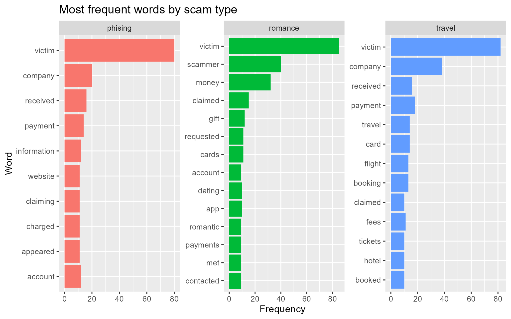
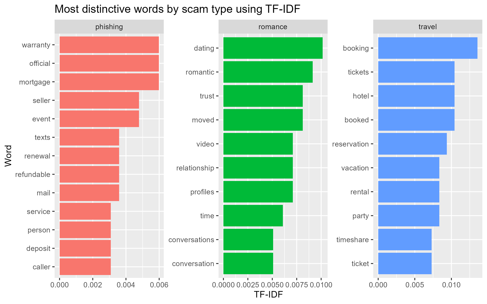

# Classifying Online Scam Reports Using Text Mining and Machine Learning

**MSc Crime Science with Data Science | University College London (UCL) | 2026**

## Project Overview

This project investigates whether online scam reports can be classified into three fraud categories—**phishing, romance scams, and travel scams**—using natural language processing (NLP) and supervised machine learning.

Developed as part of my MSc Crime Science with Data Science coursework at University College London, the study analysed 90 manually coded scam reports (30 per category).

The project combines exploratory text mining, TF-IDF analysis, and machine learning to investigate linguistic patterns associated with different forms of online fraud.

This repository showcases the R analysis code, model evaluation results, and visualisations rather than the full academic report.

## Research Objectives

The project addresses the research question:

**To what extent can text mining and supervised machine learning distinguish between phishing, romance, and travel scam reports?**

The main objectives were to:

- Identify frequently occurring words in different scam categories.
- Examine distinctive vocabulary using TF-IDF.
- Develop supervised machine learning models to classify scam narratives.
- Compare the performance of Naive Bayes and multinomial logistic regression.
- Evaluate the potential and limitations of automated scam classification.

## Tools and Technologies

**Programming Language:** R

**R Packages:**
- tidyverse
- tidytext
- stringr
- tidymodels
- textrecipes
- naivebayes
- discrim
- stopwords
- nnet

**Analytical Techniques:**
- Data cleaning and preprocessing
- Natural language processing (NLP)
- Text tokenisation and stopword removal
- Word frequency analysis
- Term Frequency-Inverse Document Frequency (TF-IDF)
- Supervised machine learning
- Multinomial logistic regression
- Naive Bayes classification
- Model evaluation and visualisation

## Dataset

The study used **90 manually collected and coded scam narratives**, divided into three balanced categories.

| Scam Category | Number of Reports |
|---|---:|
| Phishing | 30 |
| Romance | 30 |
| Travel | 30 |
| **Total** | **90** |

The reports were obtained from publicly available consumer scam narratives and standardised for analysis.

Each report was assigned one primary scam category according to its dominant fraud mechanism.

The individual narratives are excluded from this public portfolio to avoid redistributing potentially identifying information.

## Methodology

### 1. Data Cleaning and Preprocessing

The dataset was processed in R to prepare scam narratives for text analysis.

The process included:

- Standardising scam category labels.
- Removing unnecessary whitespace.
- Removing missing or incomplete observations.
- Tokenising text into individual words.
- Removing common stopwords.
- Retaining alphabetic tokens for analysis.

### 2. Exploratory Text Analysis

Word frequency analysis was used to identify commonly occurring terms within each scam category.

TF-IDF was then applied to identify terms that were relatively distinctive to each category, rather than simply the most frequently occurring words.

### 3. Machine Learning

Two supervised classification algorithms were evaluated:

**Naive Bayes**
- A probabilistic classification model using text features to predict scam categories.

**Multinomial Logistic Regression**
- A classification model estimating the relationship between TF-IDF features and scam category membership.

The dataset was divided using a stratified **80/20 training and testing split**.

The machine learning workflow applied tokenisation, stopword removal, vocabulary filtering, and TF-IDF transformation.

### 4. Model Evaluation

Model performance was assessed using:

- Classification accuracy
- Cohen's kappa
- Confusion matrices

These metrics were used to compare classification performance on the test dataset.

## Results

### Machine Learning Performance

| Model | Test Accuracy | Cohen's Kappa |
|---|---:|---:|
| Naive Bayes | 33.3% | 0.000 |
| Multinomial Logistic Regression | 77.8% | 0.667 |

Multinomial logistic regression outperformed Naive Bayes on the test dataset.

Naive Bayes performed at approximately chance level for the balanced three-class classification problem.

Logistic regression achieved **77.8% test accuracy**, suggesting that TF-IDF features can help distinguish the selected scam categories.

However, these findings remain exploratory due to the small sample size and overlap between fraud categories.

## Data Visualisations

### Word Frequency Analysis



This visualisation identifies commonly occurring words across phishing, romance, and travel scam reports.

The word "victim" appeared frequently across all three categories, reflecting similarities in the reporting style of scam narratives.

### TF-IDF Analysis



TF-IDF highlighted vocabulary associated with different types of scams:

- **Phishing:** warranty, official, mortgage, renewal
- **Romance:** dating, romantic, trust, relationship
- **Travel:** booking, tickets, hotel, reservation

These differences suggest that scam categories have identifiable linguistic characteristics.

## Repository Structure

```text
consumer-fraud-text-classification/
|
|-- scripts/
|   |-- bbb_scam_analysis.R
|
|-- results/
|   |-- model_comparison.csv
|   |-- naive_bayes_metrics.csv
|   |-- naive_bayes_confusion_matrix.csv
|   |-- naive_bayes_predictions.csv
|   |-- logistic_regression_metrics.csv
|   |-- logistic_regression_confusion_matrix.csv
|   |-- logistic_regression_predictions.csv
|   |-- tfidf_words_by_scam_type.csv
|
|-- figures/
|   |-- frequent_words_by_scam_type.png
|   |-- tfidf_words_by_scam_type.png
|
|-- README.md
|-- .gitignore
```

**Repository contents:**

- `scripts/` — R code for text preprocessing, exploratory analysis, machine learning, and evaluation.
- `results/` — Exported model metrics, predictions, confusion matrices, and TF-IDF outputs.
- `figures/` — Visualisations of word frequency and distinctive vocabulary.
- `README.md` — Project documentation and research findings.
- `.gitignore` — Excludes private datasets and temporary R files.

## Reproducing the Analysis

### Requirements

The analysis requires R and the following packages:

```r
install.packages(c(
  "tidyverse",
  "tidytext",
  "stringr",
  "tidymodels",
  "textrecipes",
  "naivebayes",
  "discrim",
  "stopwords",
  "nnet"
))
```

Install packages in the RStudio Console only when needed.

### Step 1. Prepare the Dataset

Place the original 90-report CSV file inside a local `data/` folder.

```text
consumer-fraud-text-classification/
|
|-- data/
|   |-- bbb_scam_reports.csv
|
|-- scripts/
|-- results/
|-- figures/
```

The source dataset is not distributed in this repository.

### Step 2. Run the R Script

Open the repository in RStudio and run:

```r
source("scripts/bbb_scam_analysis.R")
```

Run the script from the repository's main directory.

The script performs data preprocessing, text mining, machine learning, and model evaluation.

### Step 3. Review the Outputs

The analysis generates model evaluation files and visualisations in the corresponding `results/` and `figures/` directories.

Model performance can be inspected in:

`results/model_comparison.csv`

## Reproducibility Verification

The R analysis was successfully rerun in RStudio using the corrected dataset of 90 scam reports.

The reproduced model performance matched the values reported in the original academic project to three decimal places.

| Model | Accuracy | Cohen's Kappa |
|---|---:|---:|
| Naive Bayes | 0.333 | 0.000 |
| Multinomial Logistic Regression | 0.778 | 0.667 |

The category spelling was standardised to **phishing** throughout the project documentation and updated data visualisations.

The original dataset remains excluded from the public repository to protect potentially identifying information.

## Limitations

Several limitations should be considered when interpreting the findings:

- The dataset contains only 90 scam reports.
- Reports were manually collected and categorised.
- Some scam narratives contain overlapping fraud mechanisms.
- Classification performance may differ on larger or more representative datasets.
- Model accuracy does not establish operational effectiveness in detecting real-world fraud.
- The analysis uses a single train/test split rather than repeated cross-validation.

Future research could expand the dataset, evaluate additional machine learning algorithms, and investigate multi-label classification for scams involving multiple fraud mechanisms.

## Academic Context

This project was developed as part of the **MSc Crime Science with Data Science** programme at **University College London (UCL)** in 2026.

The project demonstrates practical experience in R programming, data preprocessing, natural language processing, supervised machine learning, statistical evaluation, and fraud analysis.

The repository is intended for academic and professional portfolio purposes.
